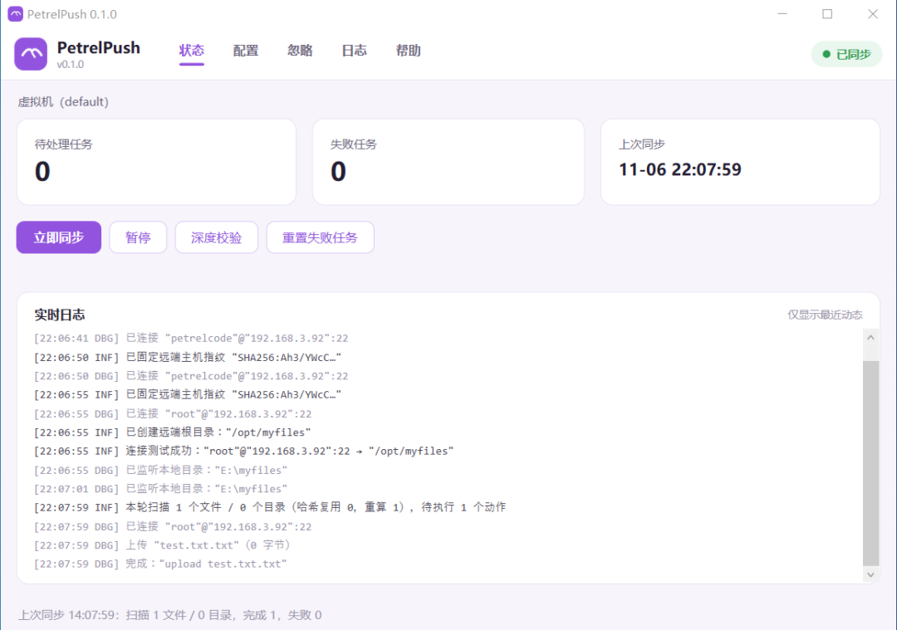
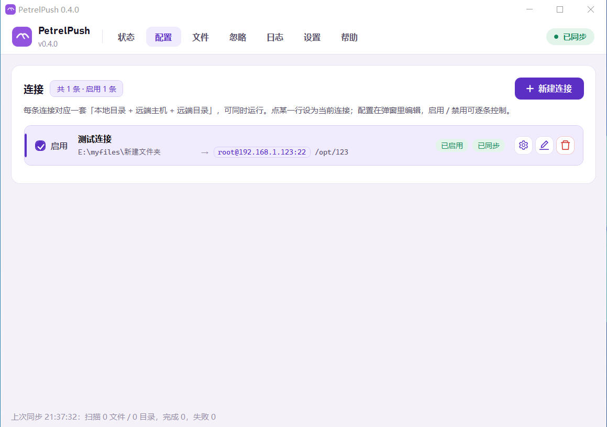
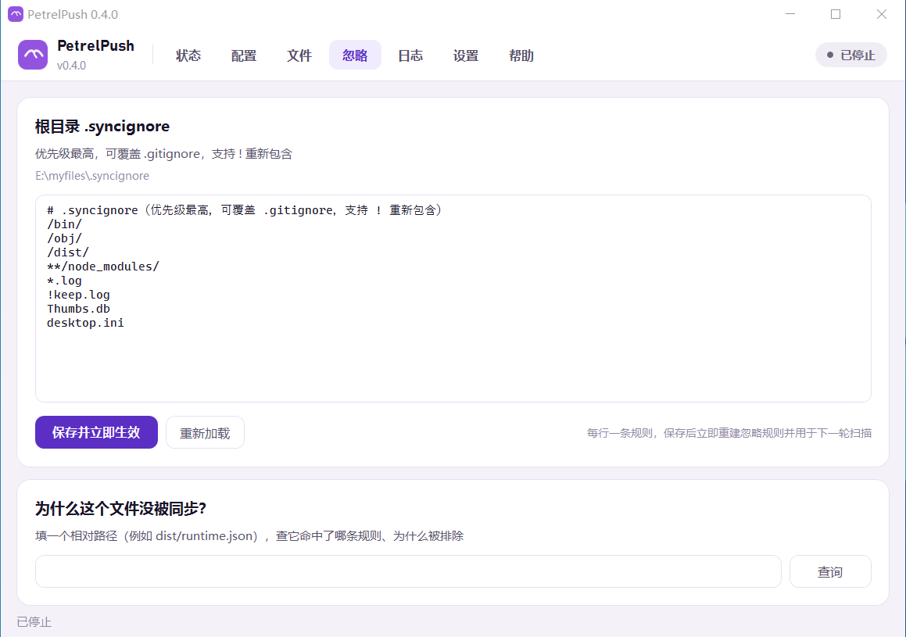
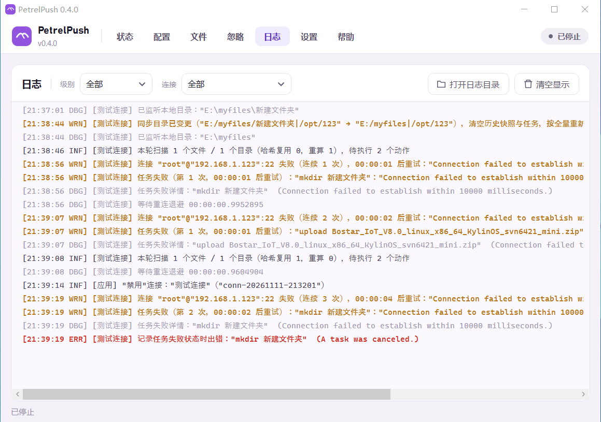
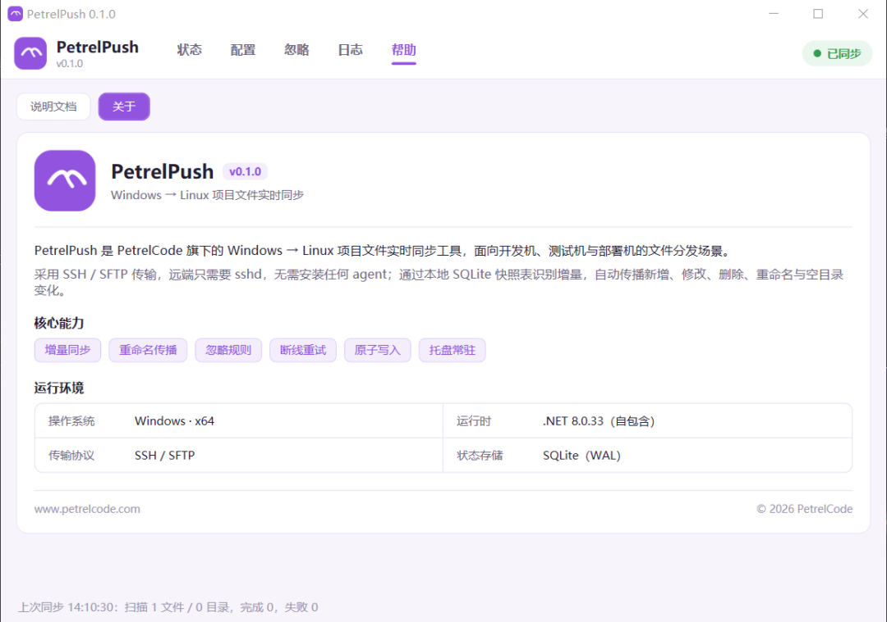
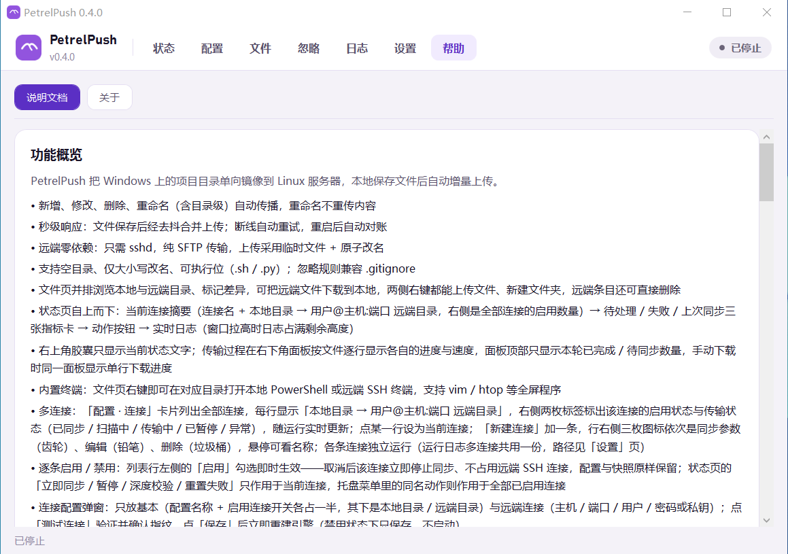

# PetrelPush

<p>
  <a href="https://github.com/PetrelCode/PetrelPush/actions/workflows/ci.yml"></a>
  <a href="https://github.com/PetrelCode/PetrelPush/releases/latest"></a>
  <a href="https://github.com/PetrelCode/PetrelPush/releases"></a>
  <a href="LICENSE"></a>
  <a href="https://github.com/PetrelCode/PetrelPush/commits/main"></a>
  <a href="https://github.com/PetrelCode/PetrelPush/releases"></a>
</p>

<p>
  <a href="https://github.com/PetrelCode/PetrelPush/stargazers"></a>
  <a href="https://github.com/PetrelCode/PetrelPush/forks"></a>
  <a href="https://github.com/PetrelCode/PetrelPush/issues"></a>
  <a href="https://github.com/PetrelCode/PetrelPush/pulls"></a>
  <a href="https://github.com/PetrelCode/PetrelPush/graphs/contributors"></a>
</p>

<p>
  
  
  
  
  
  
  <a href="https://www.petrelcode.com"></a>
</p>

<p>
  <a href="https://github.com/PetrelCode/PetrelPush"></a>
  <a href="https://github.com/PetrelCode/PetrelPush"></a>
  <a href="https://github.com/PetrelCode/PetrelPush"></a>
  <a href="https://github.com/PetrelCode/PetrelPush"></a>
</p>

> Windows → Linux 项目文件实时同步工具

PetrelPush 是 [PetrelCode](https://www.petrelcode.com) 旗下的 Windows 桌面工具，面向开发机、测试机与部署机的文件分发场景：把本地项目目录**实时单向镜像**到 Linux 服务器。远端只需要 sshd，不需要安装任何 agent；工具也**不读写你的 `.git`**，不会干扰 `git add / commit / gc / push`。

## 特性

- **实时增量同步**：文件系统监听 + 500ms 去抖，新增、修改、删除秒级传播
- **重命名识别**：文件级、目录级 rename 直接映射为远端 `rename`，不重传内容；支持仅大小写不同的重命名
- **最终一致**：本地 SQLite 快照表记录 `path / size / mtime / sha256` 与远端已同步哈希，事件丢失、断网、进程重启后自动对账
- **断线自愈**：失败指数退避重试，任务持久化，网络恢复后自动补齐
- **忽略规则**：内置规则 + 逐目录 `.gitignore` + 根目录 `.syncignore`（优先级最高，支持 `!` 重新包含），修改即时生效
- **深度校验**：定期或手动忽略 mtime 捷径、全量重算哈希，兜住“内容变了但时间戳没变”
- **传输优化**：SFTP 连接池（默认 4 路并发）、应用层限速、临时文件 + 原子 rename 写入
- **安全**：主机指纹（TOFU）校验、密码 / 私钥两种认证、凭据经 Windows DPAPI 加密落盘、日志脱敏
- **托盘 UI**：状态、配置、忽略、日志、帮助五个页面；常驻托盘，支持开机自启
- **常用操作**：立即同步、暂停 / 恢复、深度校验、重置失败任务
- **状态总览**：待处理任务、失败任务、上次同步时间，附实时日志
- **忽略排查**：忽略页编辑根目录 `.syncignore`，或粘贴路径查询“为什么这个文件没被同步”
- **日志查看**：按级别筛选、打开日志目录、清空显示
- **命令行**：`init / run / test / check-ignore / profiles`，便于首次验收和自动化
- **MSI 安装包**：WiX 打包，自包含发布（无需预装 .NET），卸载清理用户数据

## 界面预览

| 状态 | 配置 |
|---|---|
|  |  |
| **忽略规则** | **日志** |
|  |  |
| **帮助 · 关于** | **帮助 · 说明文档** |
|  |  |

## 工作原理

```text
Windows 本地目录
  ├─ FS Watcher            只产生“该检查了”的廉价信号
  ├─ 扫描器 + 忽略规则      .gitignore / .syncignore，不调用 git
  ├─ SQLite 快照表          path + size + mtime + sha256 + 远端已知哈希
  └─ Diff → 任务队列 → SFTP 连接池（原子写 / rename / delete / mkdir）
                                   │
                                   ▼
                        Linux 目标目录（仅需 sshd）
```

正确性由快照对比保证，而不是由监听事件保证：事件只是触发器，丢失或重启最多影响延迟，不影响最终结果。

## 环境要求

| 项目 | 要求 |
|---|---|
| 客户端 | Windows 10 / 11（x64） |
| 服务端 | 任意 Linux，启用 sshd 与 SFTP 子系统（OpenSSH 默认配置即可） |
| 运行时 | 安装包自包含 .NET 8；从源码构建需 .NET 8 SDK |
| 状态存储 | SQLite（WAL 模式） |
| 打包 | WiX Toolset 5（通过 NuGet 自动还原，无需单独安装） |
| 其他 | 不需要 Git、rsync 或远端 agent |

## 快速开始

### 获取源码

```powershell
git clone https://github.com/PetrelCode/PetrelPush.git
cd PetrelPush
```

### 构建安装包

```powershell
powershell -ExecutionPolicy Bypass -File installer\build-msi.ps1 -Version 0.1.0
```

输出：`artifacts\PetrelPushSetup-0.1.0-x64.msi`（x64，perMachine 安装到 `C:\Program Files\PetrelPush`）。

### 从源码运行

```powershell
dotnet run --project PetrelPush.App
```

### 首次配置

1. 打开「配置」页，填写**配置名称**与**本地目录**（Windows 路径）
2. 填写**远端目录**（Linux 绝对路径，不存在会自动创建）
3. 填写主机、端口、用户名，选择认证方式：**密码**（DPAPI 加密保存）或 **OpenSSH 私钥**（支持带口令的私钥）
4. 点「测试连接」：首次连接会固定主机指纹（TOFU），成功后配置保存并立即生效
5. 点「保存并应用」：首次会全量上传，完成后状态显示「已同步」
6. 之后可在「忽略」页维护 `.syncignore`，在「日志」页按级别查看运行日志

> 首次验收可先勾选 dry-run，只查看变更集而不写入远端。

### 命令行

```powershell
# 创建 profile
PetrelPush init --profile dev --local D:\work\myapp --remote-root /srv/myapp `
    --host 192.168.1.10 --port 22 --user root --password "your-password"

# 测试连接
PetrelPush test --profile dev

# 只跑一轮（首次验收）
PetrelPush run --profile dev --once

# 常驻运行
PetrelPush run --profile dev

# 检查某个路径是否被忽略及原因
PetrelPush check-ignore --profile dev --path dist/runtime.json
```

CLI 编译产物位于 `PetrelPush.Cli\bin\Release\net8.0\PetrelPush.exe`，与桌面端共用同一份 profile 配置。

## Linux 端准备

- 启动 sshd 并保证 SFTP 可用（`Subsystem sftp` 为默认配置，通常无需改动）
- 目标目录对登录用户可写；使用 root 时无需额外授权
- 密码认证需允许 `PasswordAuthentication`（部分发行版通过 PAM 走 `KbdInteractiveAuthentication`，客户端会自动回退）
- 私钥认证建议使用 ed25519：`ssh-keygen -t ed25519`，公钥追加到目标账号的 `~/.ssh/authorized_keys`（目录 700、文件 600）
- 若启用了 fail2ban，建议把客户端 IP 加入白名单（客户端已做长连接保活与串行重连）

## 配置与数据位置

| 内容 | 位置 |
|---|---|
| 同步配置 | `%APPDATA%\PetrelPush\profiles\<id>\config.json` |
| 凭据 | `%APPDATA%\PetrelPush\profiles\<id>\secrets.bin`（DPAPI CurrentUser 加密，换用户/换机不可解密） |
| 状态库 | `%APPDATA%\PetrelPush\profiles\<id>\state.db`（SQLite 快照表） |
| 日志 | `%APPDATA%\PetrelPush\profiles\<id>\logs\PetrelPush-*.log`（按天滚动） |
| 忽略规则 | `<本地目录>\.syncignore`（文件名可通过配置修改） |
| 开机自启 | `HKCU\Software\Microsoft\Windows\CurrentVersion\Run` 下的 `PetrelPush` 值 |

卸载时会删除所有本地用户的上述用户数据目录及开机自启项，重装后需重新配置。

## 构建与测试

```powershell
dotnet restore PetrelPush.sln
dotnet build PetrelPush.sln -c Release
dotnet test PetrelPush.Tests\PetrelPush.Tests.csproj -c Release
```

测试覆盖忽略规则语义、哈希捷径、diff 与重命名配对、任务排序、路径穿越防护、退避计算、配置存储等。

## 项目结构

| 目录 | 说明 |
|---|---|
| `PetrelPush.App` | WPF 托盘应用（状态 / 配置 / 忽略 / 日志 / 帮助） |
| `PetrelPush.Core` | 扫描、忽略规则、哈希、diff、同步引擎、配置模型 |
| `PetrelPush.State` | SQLite 快照库与任务持久化 |
| `PetrelPush.Transport` | SFTP 传输层（连接池、原子写、限速） |
| `PetrelPush.Cli` | 命令行宿主 |
| `PetrelPush.Tests` | xUnit 单元测试 |
| `installer` | WiX 安装包定义、构建脚本与卸载清理脚本 |

## 已知限制

- 单向同步（本地 → 远端），不做双向合并与冲突处理
- 远端被手工修改后不会主动检测并修复（v1 不扫描远端）
- 不支持同步历史回滚
- 仅提供 Windows 客户端
- 单机单用户常驻，通过单实例互斥避免状态库并发写

## 参与贡献

欢迎提交 Issue 与 Pull Request。提交前请确保 `dotnet build` 与 `dotnet test` 均通过；涉及界面或样式的改动请遵循项目内的设计规范。

## 许可证

[MIT](LICENSE)

---

© 2026 PetrelCode · [www.petrelcode.com](https://www.petrelcode.com)
