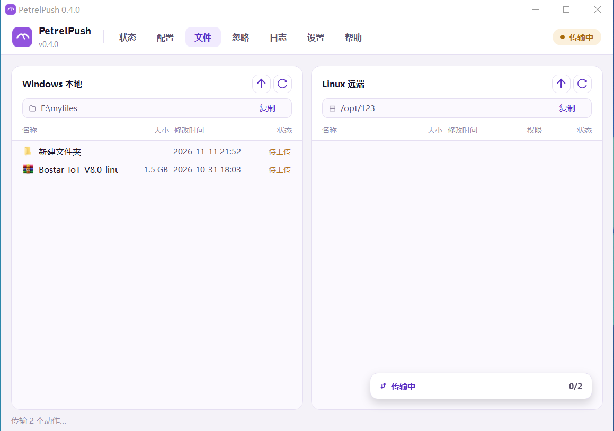
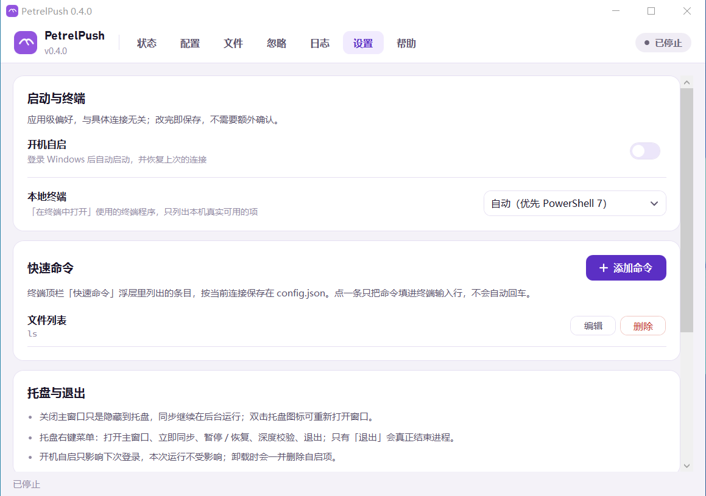

# PetrelPush

<p>
  <a href="https://github.com/PetrelCode/PetrelPush/actions/workflows/ci.yml"></a>
  <a href="https://github.com/PetrelCode/PetrelPush/releases/latest"></a>
  <a href="https://github.com/PetrelCode/PetrelPush/releases"></a>
  <a href="LICENSE"></a>
</p>

<p>
  
  
  
  
  
  
  <a href="https://www.petrelcode.com"></a>
</p>

> Windows → Linux 项目文件实时同步工具

PetrelPush 是 [PetrelCode](https://www.petrelcode.com) 旗下的 Windows 桌面工具，面向开发机、测试机与部署机的文件分发场景：把本地项目目录**实时单向镜像**到 Linux 服务器。远端只需要 sshd，不需要安装任何 agent；工具也**不读写你的 `.git`**，不会干扰 `git add / commit / gc / push`。

## 特性

- **实时增量同步**：文件系统监听 + 500ms 去抖，新增、修改、删除秒级传播
- **重命名识别**：文件级、目录级 rename 直接映射为远端 `rename`，不重传内容；支持仅大小写不同的重命名
- **最终一致**：本地 SQLite 快照表记录 `path / size / mtime / sha256` 与远端已同步哈希，事件丢失、断网、进程重启后自动对账
- **断线自愈**：失败指数退避重试，任务持久化，网络恢复后自动补齐
- **忽略规则**：内置规则 + 逐目录 `.gitignore` + 根目录 `.syncignore`（优先级最高，支持 `!` 重新包含），修改即时生效
- **深度校验**：定期或手动忽略 mtime 捷径、全量重算哈希，兜住“内容变了但时间戳没变”
- **目录变更自愈**：本地目录或远端根目录改动后，引擎会比对目录签名并自动清空旧快照、按全量重新上传到新远端目录（无需手工删 `state.db`）
- **传输优化**：SFTP 连接池（默认 4 路并发）、应用层限速、临时文件 + 原子 rename 写入
- **安全**：主机指纹（TOFU）校验（指纹与 host:port 绑定，改 IP / 端口后需重新测试连接确认；同地址指纹变化须弹窗确认后才更新）、密码 / 私钥两种认证、凭据经 Windows DPAPI 加密落盘、日志脱敏
- **多连接**：「配置 · 连接」卡片列出全部连接，每行左侧是「启用」胶囊开关，中间上行显示配置名称、下行按「本地目录 → 用户@主机:端口（胶囊） 远端目录」排列（两侧路径各自省略，悬停看全量），右侧两枚标签实时标出启用状态与传输状态，再往右是同步参数 / 编辑 / 删除三枚图标。点某一行设为当前连接，可新建、编辑、删除；每条连接各自独立的本地目录、远端主机、凭据、快照库与日志目录，可同时运行。逐条「启用」开关即时生效——关掉后不再启动引擎、不占远端连接，配置与快照保留；托盘图标与「立即同步 / 暂停 / 深度校验」作用于全部已启用连接
- **连接配置弹窗**：内容直接铺在窗口上，不套卡片。基本区首行「配置名称」与「启用连接」开关各占一半，其下是本地目录 / 远端目录；远端连接区两列排布（主机 + 端口 / 用户名 + 认证方式），主机指纹贴在区块标题右侧。底部「测试连接」验证并确认指纹、「保存」后立即重建引擎。同步参数不在弹窗里，新建连接一律使用默认值
- **同步参数弹窗**：列表每行右侧的齿轮图标（悬停提示「同步参数」）打开独立弹窗，管理去抖、强制触发、轮询、深度校验、并发、限速、大文件阈值、可执行后缀与空目录策略，只作用于该行连接，保存后立即重建引擎；「设置」页放应用级偏好（开机自启、本地终端、存储路径）与按连接保存的「快速命令」
- **托盘 UI**：状态、配置、文件、忽略、日志、设置、帮助七个页面；常驻托盘
- **常用操作**：立即同步、暂停 / 恢复、深度校验、重置失败任务
- **状态总览**：顶部一张摘要卡显示当前连接名与「本地目录 → 用户@主机:端口 远端目录」，右侧是全部连接的启停数量；下方待处理任务、失败任务、上次同步时间三张指标卡；最下面是实时日志，窗口拉高时日志占满剩余高度。右上角胶囊只显示当前状态文字，传输过程在右下角浮动面板按文件逐行显示各自的进度条与速度，面板顶部只显示本轮「已完成 / 待同步」数量；手动下载时同一面板显示单行下载进度
- **文件浏览与下载**：双栏并排查看 Windows 本地目录与 Linux 远端目录，逐层加载不递归，图标取自 Windows 系统图标；每栏标题右侧是「上一级 / 刷新」按钮，下方路径条可一键复制当前路径；列表按 名称 / 大小 / 修改时间 / 状态（远端多一列权限）分列，本地侧标记「已同步 / 待上传 / 已忽略」，远端侧标记「本地存在 / 仅远端」并显示 Linux 权限位；本地列表右键可在资源管理器中打开对应目录、可删除条目（移入回收站，远端随之删除）；支持在远端文件上右键把文件下载到本地
- **右键上传与新建文件夹**：文件页左右两栏的右键菜单都提供「上传文件」与「新建文件夹」——左侧把本机文件复制到本地当前目录、新建的文件夹也建在本地，随后由同步引擎上传；右侧则直接写入远端当前目录（SFTP 创建，同名文件先二次确认，均不进入同步队列）
- **远端删除**：远端列表右键「删除」直接移除服务器上的文件，选中文件夹时连同内容递归删除（符号链接只删链接本身，不进回收站）；同步按本地变更单向推进，删掉远端不会被自动补传
- **内置终端**：文件页左右两栏右键「在终端中打开」，本地侧基于 Windows ConPTY 启动 shell（自动优先 PowerShell 7；「设置」页可从本机检测到的 PowerShell 7 / Windows PowerShell / cmd / Git Bash / WSL 中选，也可选 Windows Terminal 改用独立窗口打开），远端侧通过 SSH 申请 PTY 并自动 `cd` 到当前目录；支持 `vim` / `top` / `htop` 等全屏程序、256 色、中文宽字符、鼠标选中复制、窗口缩放后远端自动重排；鼠标右键无选中内容时直接粘贴剪贴板，有选中内容时复制所选（不弹浏览器右键菜单）
- **终端快速入口**：终端窗口顶栏的「快速命令」「快速路径」在按钮下方弹出选择浮层——选中一条只把命令或 `cd` 命令填进输入行，按回车才执行；命令带名称，在「设置」页的「快速命令」里增删改（本地 / 远端共用一份），路径在浮层内添加或移除（本地与远端各存一份）
- **拖拽上传**：文件拖到左侧本地列表即复制到本地当前目录（由同步引擎上传）；拖到右侧远端列表则直接上传到远端当前目录，不写入本地（默认系统「下载」目录，临时文件 + 原子替换 + 大小校验）
- **忽略排查**：忽略页直接编辑根目录 `.syncignore`（「保存并立即生效」重建规则，「重新加载」丢弃未保存改动），或粘贴相对路径查询“为什么这个文件没被同步、命中了哪条规则”
- **日志查看**：按「级别 + 连接」双维度筛选（连接下拉为「全部 / 应用 / 各条连接」）、打开日志目录、清空显示；多连接共用一条日志流，每行前缀 `[连接名]` 标出所属连接（应用自身日志为 `[应用]`），界面与日志文件格式一致
- **命令行**：`init / run / test / check-ignore / profiles`，便于首次验收和自动化
- **MSI 安装包**：WiX 打包，中文安装向导，自包含发布（无需预装 .NET），卸载清理用户数据

## 界面预览

| 状态 | 配置 |
|---|---|
|  |  |
| **文件** | **设置** |
|  |  |
| **忽略规则** | **日志** |
|  |  |
| **帮助 · 关于** | **帮助 · 说明文档** |
|  |  |

## 工作原理

```text
Windows 本地目录
  ├─ FS Watcher            只产生“该检查了”的廉价信号
  ├─ 扫描器 + 忽略规则      .gitignore / .syncignore，不调用 git
  ├─ SQLite 快照表          path + size + mtime + sha256 + 远端已知哈希
  └─ Diff → 任务队列 → SFTP 连接池（原子写 / rename / delete / mkdir）
                                   │
                                   ▼
                        Linux 目标目录（仅需 sshd）
```

正确性由快照对比保证，而不是由监听事件保证：事件只是触发器，丢失或重启最多影响延迟，不影响最终结果。

## 环境要求

| 项目 | 要求 |
|---|---|
| 客户端 | Windows 10 / 11（x64）；内置终端需要 Windows 10 1809 以上 |
| WebView2 | 终端渲染依赖 Microsoft Edge WebView2 Runtime（Windows 11 预装；Windows 10 随 Edge 更新安装） |
| 服务端 | 任意 Linux，启用 sshd 与 SFTP 子系统（OpenSSH 默认配置即可） |
| 运行时 | 安装包自包含 .NET 8；从源码构建需 .NET 8 SDK |
| 状态存储 | SQLite（WAL 模式） |
| 打包 | WiX Toolset 5（通过 NuGet 自动还原，无需单独安装） |
| 其他 | 不需要 Git、rsync 或远端 agent |

## 快速开始

### 获取源码

```powershell
git clone https://github.com/PetrelCode/PetrelPush.git
cd PetrelPush
```

### 构建安装包

```powershell
powershell -ExecutionPolicy Bypass -File installer\build-msi.ps1 -Version 0.4.0
```

输出：`artifacts\PetrelPushSetup-0.4.0-x64.msi`（x64，perMachine 安装到 `C:\Program Files\PetrelPush`）。

安装向导界面语言由 `installer\PetrelPush.Setup.wixproj` 的 `<Cultures>zh-CN</Cultures>` 决定，使用 WiXUI 自带的中文本地化；如需英文界面改为 `en-US` 即可。

### 从源码运行

```powershell
dotnet run --project PetrelPush.App
```

### 首次配置

1. 打开「配置」页，「连接」卡片里已有默认连接；需要更多目标点右上角「新建连接」
2. 点该行右侧的铅笔图标（悬停提示「编辑连接」）打开连接配置弹窗，首行填写**配置名称**（右侧「启用连接」开关决定保存后是否立即启动同步），再填**本地目录**（Windows 路径）
3. 填写**远端目录**（Linux 绝对路径，不存在会自动创建）
4. 填写主机、端口、用户名，选择认证方式：**密码**（DPAPI 加密保存）或 **OpenSSH 私钥**（支持带口令的私钥）
5. 点弹窗底部「测试连接」：首次连接会固定主机指纹（TOFU），成功后按配置完整度自动启用；再点「保存」让配置生效。指纹与当时的 host:port 绑定，之后修改 IP / 端口旧指纹会自动作废，再点一次「测试连接」即可重新确认；同一地址上远端重装 / 换机导致指纹变化时，会弹窗要求确认后才更新
6. 需要调整去抖、轮询、并发、限速、空目录等同步参数时，点该行的齿轮图标（悬停提示「同步参数」），在弹窗里改完点「保存」；首次会全量上传，完成后状态显示「已同步」
7. 之后可在「忽略」页维护 `.syncignore`，在「日志」页按级别查看运行日志
8. 需要同步到别的机器 / 目录时重复以上步骤新建一条连接；暂时不用的连接关掉列表里该行的「启用」开关即可停掉

> 首次验收可先勾选 dry-run，只查看变更集而不写入远端。

### 命令行

```powershell
# 创建 profile
PetrelPush init --profile dev --local D:\work\myapp --remote-root /srv/myapp `
    --host 192.168.1.10 --port 22 --user root --password "your-password"

# 测试连接
PetrelPush test --profile dev

# 只跑一轮（首次验收）
PetrelPush run --profile dev --once

# 常驻运行
PetrelPush run --profile dev

# 检查某个路径是否被忽略及原因
PetrelPush check-ignore --profile dev --path dist/runtime.json
```

CLI 编译产物位于 `PetrelPush.Cli\bin\Release\net8.0\PetrelPush.exe`，与桌面端共用同一份 profile 配置。

## Linux 端准备

- 启动 sshd 并保证 SFTP 可用（`Subsystem sftp` 为默认配置，通常无需改动）
- 目标目录对登录用户可写；使用 root 时无需额外授权
- 密码认证需允许 `PasswordAuthentication`（部分发行版通过 PAM 走 `KbdInteractiveAuthentication`，客户端会自动回退）
- 私钥认证建议使用 ed25519：`ssh-keygen -t ed25519`，公钥追加到目标账号的 `~/.ssh/authorized_keys`（目录 700、文件 600）
- 若启用了 fail2ban，建议把客户端 IP 加入白名单（客户端已做长连接保活与串行重连）

## 配置与数据位置

| 内容 | 位置 |
|---|---|
| 同步配置 | `%APPDATA%\PetrelPush\profiles\<id>\config.json` |
| 凭据 | `%APPDATA%\PetrelPush\profiles\<id>\secrets.bin`（DPAPI CurrentUser 加密，换用户/换机不可解密） |
| 状态库 | `%APPDATA%\PetrelPush\profiles\<id>\state.db`（SQLite 快照表） |
| 日志 | `%APPDATA%\PetrelPush\profiles\<id>\logs\PetrelPush-*.log`（按天滚动；多连接共用一份，每行带 `[连接名]`） |
| 忽略规则 | `<本地目录>\.syncignore`（文件名可通过配置修改） |
| 开机自启 | `HKCU\Software\Microsoft\Windows\CurrentVersion\Run` 下的 `PetrelPush` 值 |

卸载时会删除所有本地用户的上述用户数据目录及开机自启项，重装后需重新配置。

## 构建与测试

```powershell
dotnet restore PetrelPush.sln
dotnet build PetrelPush.sln -c Release
dotnet test PetrelPush.Tests\PetrelPush.Tests.csproj -c Release
```

测试覆盖忽略规则语义、哈希捷径、diff 与重命名配对、任务排序、路径穿越防护、退避计算、配置存储、远端文件名合法化与浏览状态标记等。

## 项目结构

| 目录 | 说明 |
|---|---|
| `PetrelPush.App` | WPF 托盘应用（状态 / 配置 / 文件 / 忽略 / 日志 / 设置 / 帮助）；`Terminal/` 为终端渲染层（xterm.js 资源 + ConPTY 会话） |
| `PetrelPush.Core` | 扫描、忽略规则、哈希、diff、同步引擎、配置模型 |
| `PetrelPush.State` | SQLite 快照库与任务持久化 |
| `PetrelPush.Transport` | SFTP 传输层（连接池、原子写、限速） |
| `PetrelPush.Cli` | 命令行宿主 |
| `PetrelPush.Tests` | xUnit 单元测试 |
| `installer` | WiX 安装包定义、构建脚本与卸载清理脚本 |

## 已知限制

- 单向同步（本地 → 远端），不做双向合并与冲突处理
- 远端被手工修改后不会主动检测并修复（v1 不扫描远端）；「文件」页的远端列表只做浏览与手工操作（下载 / 上传 / 新建目录 / 删除），不参与 diff，也不改变同步队列
- 远端浏览范围限定在配置的远端目录之内，单个目录最多显示 2000 项
- 内置终端内可执行任意命令，**不受**「浏览范围限定在远端目录之内」这条只读约束；窗口顶部会显示当前登录的主机与用户，操作前请确认目标机器
- 每个终端窗口独立建立一条 SSH 连接（不进传输连接池，也不与其它终端窗口共享）
- 拖拽直传到远端的文件不写入本地目录，之后在列表里显示为「仅远端」，引擎不会自动删除
- 不支持同步历史回滚
- 仅提供 Windows 客户端
- 单机单用户常驻，通过单实例互斥避免状态库并发写

## 参与贡献

欢迎提交 Issue 与 Pull Request。提交前请确保 `dotnet build` 与 `dotnet test` 均通过；涉及界面或样式的改动请遵循项目内的设计规范。

## 许可证

[MIT](LICENSE)

---

© 2026 PetrelCode · [www.petrelcode.com](https://www.petrelcode.com)
